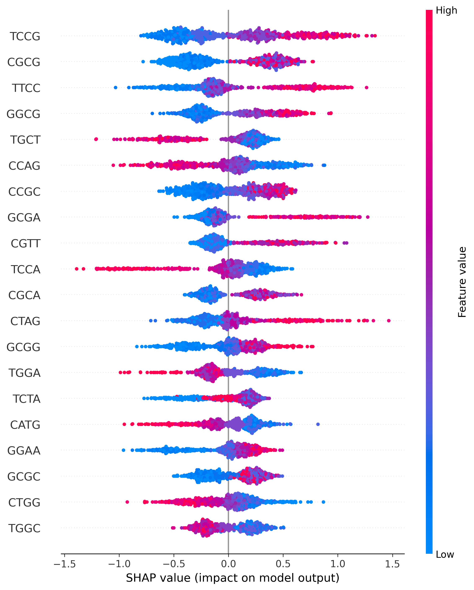
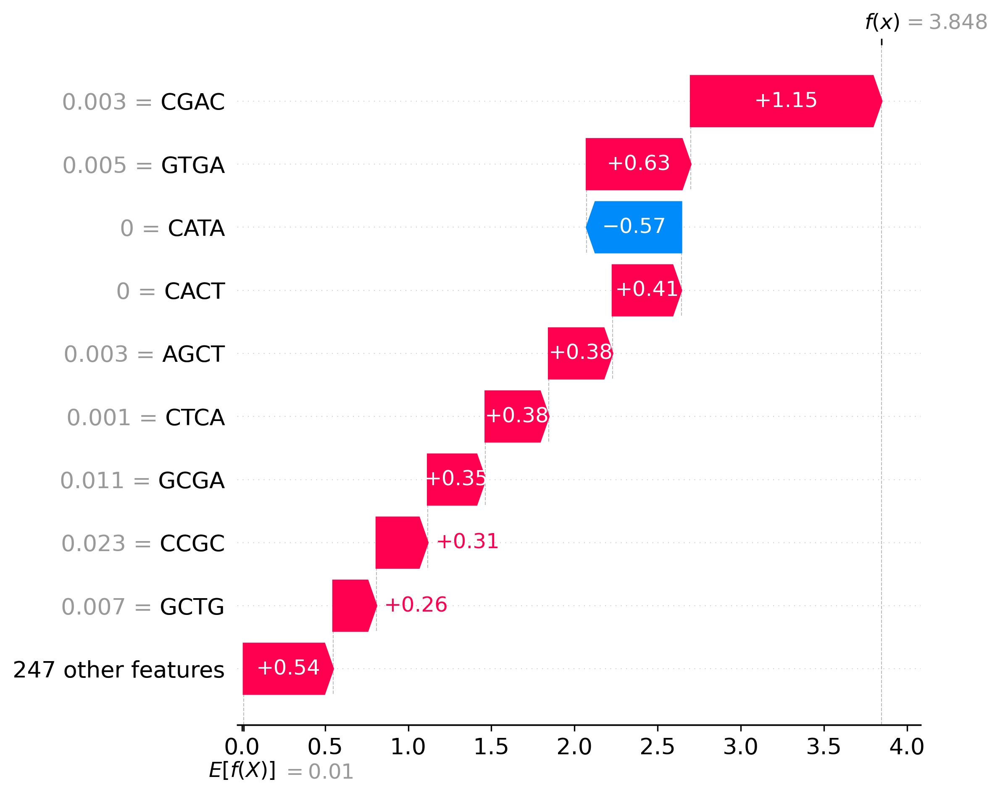
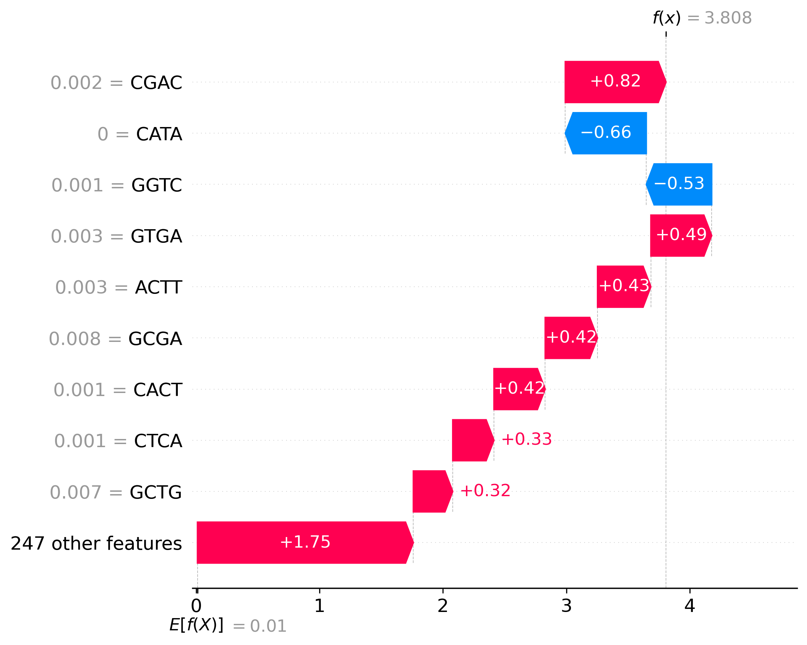
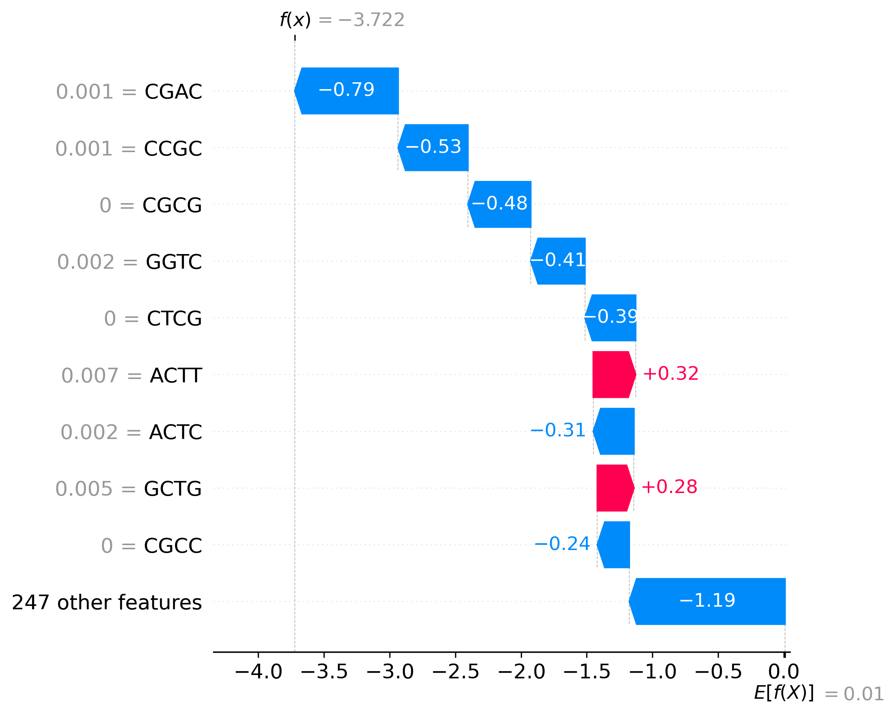
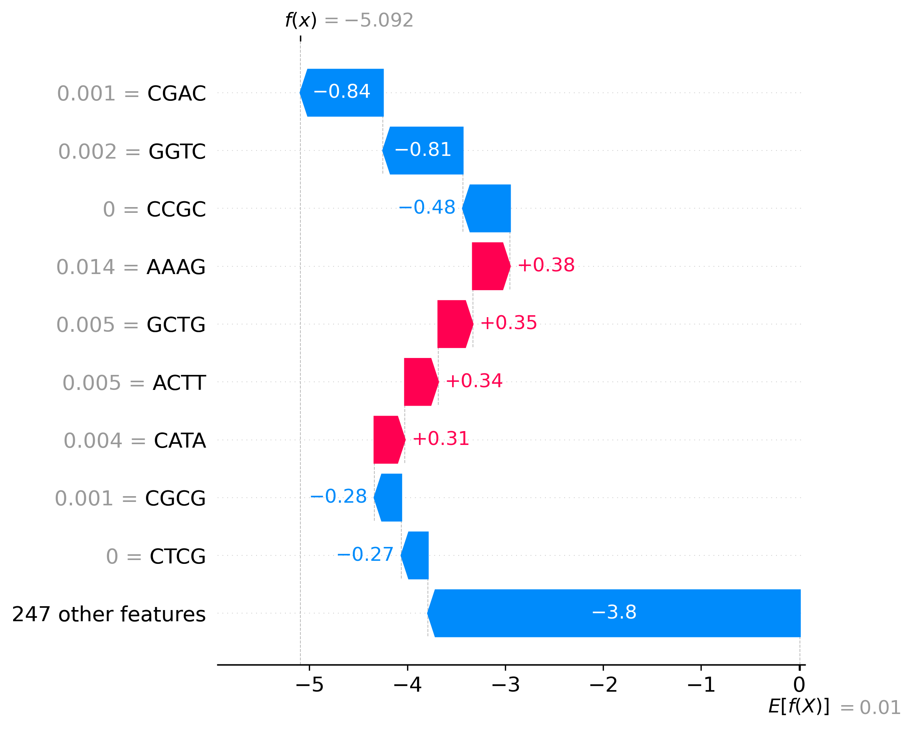
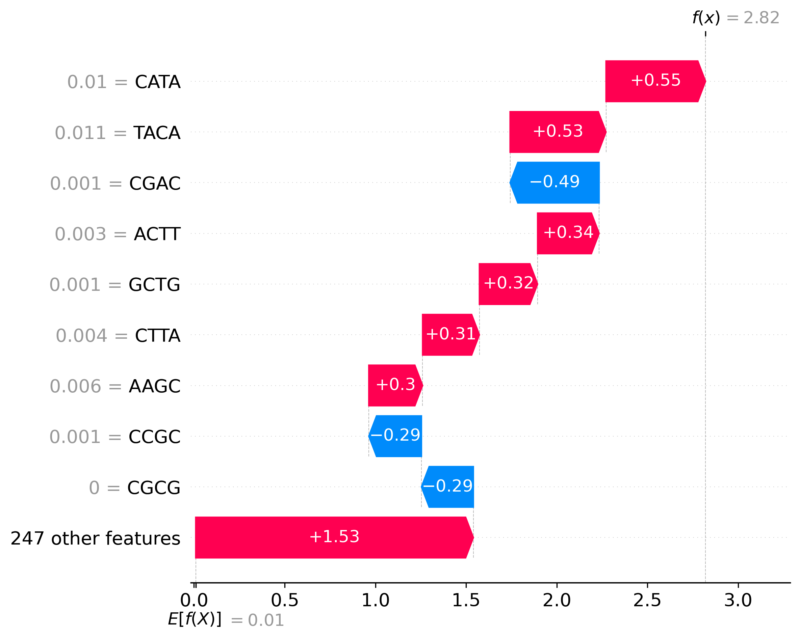

# Phase 1 Completed: Classical Interpretable Baselines & SHAP Explainability

- Discussion: https://github.com/PxA-Labs/interpretable-regulatory-genomics/discussions/1
- Category: Show and tell
- Author: purvanshjoshi
- Created: 2026-06-13T06:23:43Z
- Updated: 2026-06-23T15:13:14Z
- Labels: none

## Original post

## Introduction and Goals of Phase 1
We have completed Phase 1 of the modeling roadmap, focusing on establishing classical interpretable baseline models. The objective of this phase is to train, evaluate, and interpret classical machine learning models (Logistic Regression, Random Forest, and XGBoost) on normalized k-mer frequencies (k=4) extracted from ENCODE human candidate cis-Regulatory Elements (cCREs). This baseline establishes a performance benchmark and interpretability baseline before we move to deep learning architectures. All results exceed the threshold of AUROC >= 0.75 set by Decision Gate 1 to 2.

---

## Detailed Performance Analysis
The models were trained on coordinates centered and resized to 1000 base pairs, using a GC-matched negative sampling strategy to ensure the models do not simply learn background GC content. Evaluation was performed on a chromosome 19 test partition:

| Model | AUROC | AUPRC | F1-Score | Log Loss | Train Time (s) |
|---|---|---|---|---|---|
| Logistic Regression (L1/L2) | 0.792012 | 0.764318 | 0.740448 | 0.658786 | 0.02 |
| Random Forest (500 estimators) | 0.877309 | 0.896872 | 0.794233 | 0.475161 | 3.52 |
| XGBoost (500 estimators) | **0.887699** | **0.900208** | **0.787565** | **0.569034** | 1.21 |

### Metric Breakdown:
- **AUROC (Area Under the Receiver Operating Characteristic)**: Measures the probability that the model ranks a randomly chosen positive regulatory element higher than a randomly chosen non-coding negative region. XGBoost achieved the highest AUROC of 0.887699, followed closely by Random Forest at 0.877309. Logistic Regression lags behind at 0.792012.
- **AUPRC (Area Under the Precision-Recall Curve)**: Especially useful for genomic sequence classification as it is highly sensitive to false positives. The tree ensembles show exceptional precision-recall performance (XGBoost AUPRC = 0.900208, Random Forest AUPRC = 0.896872), outperforming Logistic Regression by nearly 14%.
- **Log Loss**: Measures the uncertainty of the probability predictions. Random Forest achieved the lowest Log Loss (0.475161), indicating more calibrated probability estimates than Logistic Regression and XGBoost.
- **Train Time**: Logistic Regression fitted almost instantly (0.02 seconds), while XGBoost (1.21 seconds) and Random Forest (3.52 seconds) remain highly feasible for fast iteration on Kaggle CPU environments.

### Why Tree Ensembles Outperform Linear Baselines:
The substantial performance difference (~10% AUROC improvement) indicates that regulatory sequences contain complex non-linear combinations and spatial interactions of k-mers that linear models like Logistic Regression cannot capture. Tree-based ensembles naturally partition the feature space to learn cooperative k-mer interactions (e.g., the co-occurrence of multiple motifs within the same 1 kb region), whereas Logistic Regression is constrained to independent linear weights.

---

## Biological Interpretation of Features

### 1. Logistic Regression Coefficients
Logistic Regression assigns a direct weight (coefficient) to each k-mer, representing its linear influence on the active regulatory prediction:
- **Top Positive Associated 4-mers**: GCGG (+2.49), GGCG (+2.38), GCGC (+2.31), CGCG (+2.21), CCGC (+2.07)
- **Top Negative Associated 4-mers**: CCTG (-1.78), CTGG (-1.77), CCAG (-1.74), CAGG (-1.66)

### 2. Random Forest Gini Importance
Gini importance measures the total decrease in node impurity (weighted by the probability of reaching that node) averaged over all 500 trees:
- The top-ranked features are: CGCG (0.023928), GCGC (0.017949), CCGC (0.017448), CCTG (0.015004), GCGG (0.014712), and GGCG (0.014338).

### 3. Biological Significance (CpG Islands)
There is a remarkable consensus between the top features identified by both classical models. The most important positive features are CpG-dinucleotide-containing k-mers (CGCG, GCGC, GGCG, GCGG, CCGC). 
In the human genome, active promoter-like elements and enhancers are highly enriched for CpG islands (unmethylated CG-rich genomic regions). The models have successfully captured this biological truth purely from sequence frequency data without prior biological annotations. Conversely, the top negative features are dominated by common Alu-repeat and background elements (like CCTG, CTGG, CCAG), which are typical signatures of non-regulatory, inert genomic regions.

---

## SHAP (Shapley Additive exPlanations) Attribution
SHAP values use game theory to explain the contribution of each feature to the final prediction of a specific sequence. Unlike global Gini importance, SHAP values provide additive attribution scores that explain both positive and negative directions for individual sequences:
- **Top 5 SHAP Features**: TCCG (0.445282), CGCG (0.382995), TTCC (0.362214), GGCG (0.313722), and TGCT (0.305126).
- **Interpretation**: TCCG and CGCG act as major positive drivers when present in sequences. The presence of TTCC and GGAA represents transcription factor binding motifs (such as the ETS-domain family and NF-kB binding sites) which are key regulators of transcription in K562 cells.

Below is the beeswarm plot showing the SHAP value distribution for the top 20 features in the XGBoost model. Each dot represents a test sequence, with red representing high frequency of the k-mer and blue representing low frequency:



---

## Code and Reproducibility
The pipeline is structured to run modularly. The code split into separate steps is available in the repository at [notebook/phase1_classical_baseline.ipynb](https://github.com/PxA-Labs/interpretable-regulatory-genomics/blob/main/notebook/phase1_classical_baseline.ipynb). It clones the repository, processes the data, fits the models, evaluates performance, and renders the SHAP plot inline.

---

## Transition to Phase 2
Having established that sequence features are highly predictive (AUROC = 0.887) and biologically interpretable, we are transitioning to Phase 2: Lightweight Deep Learning Baseline. We will design PyTorch CNNs to automatically learn spatial motif representations directly from one-hot encoded DNA sequences, comparing their prediction performance and learned filter representations to these classical benchmarks.


## Comments

### purvanshjoshi — 2026-06-18T17:12:06Z

Hi @archittmittal and team,

Following a comprehensive audit of our current codebase against the project's official 12-month delivery roadmap (available in `10-roadmap-milestones.pdf`), I identified several critical gaps in our Phase 1 implementation (Classical Baselines) that we need to address to ensure scientific rigor:

1. **k-mer Resolution Sweep (Experiment E3)**: The current pipeline in `notebook/phase1_classical_baseline.ipynb` is hardcoded to $k=4$ (256 features). The roadmap specifies a sweep for $k \in [3, 4, 5, 6]$. We must verify if higher $k$ values (like $k=5$ or $k=6$, utilizing sparse matrices) capture transcription factor binding sites better and yield a stronger baseline.
2. **Feature Ablation Study (Experiment E2)**: We need to sequentially train Random Forest and XGBoost on structured feature groups (k-mer only $\rightarrow$ +GC $\rightarrow$ +dinucleotides $\rightarrow$ +JASPAR TF motifs) to quantify the precise predictive contribution of each feature group and plot the AUROC delta curve.
3. **Negative Set Sensitivity (Experiment E7)**: To rule out the "GC-bias trap" where models simply learn to predict active regions by GC content, we must evaluate our baseline classifiers on:
   - Strategy A: GC-matched, non-overlapping background sequences (our current baseline)
   - Strategy B: Random unmatched sequences
   - Strategy C: Adjacent flanking sequences (extracting sequences surrounding active cCREs by 5kb upstream/downstream).
   - Success criterion: Validate that the AUROC difference between GC-matched and random is stable ($\Delta < 0.05$).
4. **Literature Survey / Bibliography (Milestone M1.2)**: A standalone `annotated_bibliography.md` containing annotations for $\ge 20$ papers is missing from the repository.

I've opened a repository issue to track these Phase 1 action items: #13. Let's align on prioritizing these validation checks.


### purvanshjoshi — 2026-06-21T05:46:46Z

we are starting  Phase 1 Solidification and Baseline Verification

### purvanshjoshi — 2026-06-21T05:46:58Z

## Kicking Off Phase 1 Solidification and Baseline Verification

We are officially initiating development to resolve the validation gaps and experimental checklists identified under Phase 1 (Classical Baselines) in the roadmap specifications. 

To establish a mathematically rigorous, leakage-free sequence baseline before transitioning to multi-omics or hybrid modeling, we will implement the following changes in the modular source directory:

### 1. Data Curation and Negative Sampling Refactoring
We will modify `src/data/negative_sampling.py` to accept a `strategy` parameter inside `sample_negatives_for_chromosome` and `build_negative_dataset`, supporting three distinct configurations for Experiment E7:
* **`gc_matched`**: Maintains the current baseline algorithm, utilizing a 20-bin digitize function to match the GC-content distribution of the positive cCRE set within a +/- 5% tolerance window.
* **`random_unmatched`**: Uniformly samples random genomic coordinates across active chromosomes, enforcing exclusions for all known cCRE elements, GENCODE coding exons, and sequences containing undetermined 'N' bases, without matching GC distribution.
* **`flanking`**: Generates negative intervals by shifting positive cCRE start/end coordinates by a fixed offset (default: 5,000 base pairs upstream or downstream) to evaluate model performance on immediate spatial genomic contexts.

### 2. Implementation of Modular Feature Extractors
We will create two new feature extraction modules under `src/features/`:
* **`src/features/dinucleotide.py`**: Computes the normalized frequency distributions of all 16 possible overlapping two-base combinations (e.g., AA, AC, ..., TT). The resulting output matrix will have a shape of (N, 16) of type `np.float32`.
* **`src/features/motifs.py`**: Implements a Position Weight Matrix (PWM) scanner. It will ingest Position Frequency Matrices (PFMs) from the JASPAR database, compute log-odds scoring matrices using background nucleotide priors, slide them along the 1,000bp sequence windows, and max-pool the scores along the sequence length to return a feature matrix of shape (N, M), where M is the number of target motifs.

### 3. Execution of Validation Experiments (E2, E3, E7)
We will write a centralized runner script to execute the following pipeline:
* **$k$-mer Sweep (Experiment E3)**: Sweeps $k \in [3, 4, 5, 6]$ using Random Forest (500 estimators) and XGBoost to identify the optimal token capacity.
* **Feature Ablation Study (Experiment E2)**: Trains XGBoost classifiers on incremental feature configurations: $k$-mers only $\rightarrow$ +GC $\rightarrow$ +dinucleotides $\rightarrow$ +JASPAR TF motifs, and plots the AUROC/AUPRC delta.
* **Negative Set Sensitivity (Experiment E7)**: Evaluates and compares K562 classifier performance across all three negative sampling strategies (GC-matched vs. random unmatched vs. flanking) to test for GC-confounding.

All runs will conform to the MLOps specification, saving structured `config.yaml` and `metrics.json` outputs under `experiments/logs/` and registering the metadata in `experiments/REGISTRY.md`.


### purvanshjoshi — 2026-06-21T08:30:10Z

https://www.kaggle.com/datasets/aliabedimadiseh/grch38-human-genome-dna we are using this dataset for Phase 1 Solidification and Baseline Verification


### purvanshjoshi — 2026-06-23T15:07:09Z

### Phase 1 Update: Single-Sample SHAP Explanations

We have successfully generated the individual SHAP force/waterfall plots for 5 representative test samples (Checklist item 1.1.1). Below are the visualizations.

**1. True Positive 1 (Predicted Active, Label Active)**

*Note: This sample demonstrates a high-confidence prediction where specific regulatory k-mers exert a strong positive influence, overwhelming the background base value and confirming the sequence's functional potential.*

**2. True Positive 2 (Predicted Active, Label Active)**

*Note: Similar to the first sample, this visualization highlights the consensus motif regions that collectively drive the model's high-probability activation prediction.*

**3. True Negative 1 (Predicted Background, Label Background)**

*Note: In this sample, the absence of activating motifs and the presence of suppressive or inert k-mers correctly pull the prediction probability down toward the background baseline.*

**4. True Negative 2 (Predicted Background, Label Background)**

*Note: This profile shows strong negative feature contributions, illustrating how the model confidently dismisses sequences lacking critical regulatory signatures.*

**5. Borderline (Model was uncertain ~50%)**

*Note: This sample presents a scenario where positive and negative feature contributions closely balance each other, leading to a highly uncertain prediction near the decision boundary. Such cases are valuable for identifying ambiguous regulatory sequences.*

#### What do these visualizations show?
A SHAP Waterfall plot explains exactly how the model arrived at its prediction for a single DNA sequence. 
- The base value (bottom) is the expected model output before any features are considered.
- Each horizontal bar represents a specific k-mer feature in the sequence.
- Red bars (pushing right) indicate features that increase the probability of the sequence being an active regulatory element (e.g. enhancer).
- Blue bars (pushing left) indicate features that decrease the probability.
- The final output (top) is the model's actual prediction probability for this specific sample.

#### How did we achieve this?
1. We modularized our feature extraction logic into `src/features/gc_content.py` and `src/features/onehot.py`.
2. We added a new function `explain_single_sample` to `src/interpret/shap_analysis.py` which robustly handles Scikit-Learn Random Forests and XGBoost TreeExplainers.
3. **Important Note on Notebooks:** We generated these plots using a standalone script (`scratch/generate_shap_plots.py`) instead of directly editing the Phase 1 Jupyter Notebooks. We intentionally preserved the old notebooks exactly as they are to ensure 100% backward compatibility. Our import redirections ensure the legacy notebooks still run seamlessly.

#### How users can generate these themselves
You can generate these explanations for any model or sample by using the new function:
```python
from src.interpret.shap_analysis import explain_single_sample

# Provide your trained tree ensemble model and a single sample's features
explain_single_sample(
    model=trained_xgboost_wrapper,
    X_sample=test_sequence_features,  # shape: (1, num_features)
    feature_names=kmer_names,
    output_plot_path="my_custom_waterfall.png",
    show_plot=True
)
```

*(Note: We will officially integrate these new features into updated versions of the notebooks in the future during the final pipeline consolidation step.)*


### purvanshjoshi — 2026-06-23T15:11:40Z

### Methodology: Generating the Single-Sample SHAP Visualizations

To generate the individual SHAP visualizations without disrupting existing legacy notebooks, we implemented a dedicated, decoupled workflow. Here is the detailed step-by-step technical process:

**1. Modularizing Feature Extraction**
First, we extracted the core feature engineering logic out of the data loaders to make them reusable:
- Extracted `calculate_gc_content` into [src/features/gc_content.py](https://github.com/PxA-Labs/interpretable-regulatory-genomics/blob/main/src/features/gc_content.py).
- Extracted `sequence_to_onehot` into [src/features/onehot.py](https://github.com/PxA-Labs/interpretable-regulatory-genomics/blob/main/src/features/onehot.py).

We used import redirection inside [src/data/negative_sampling.py](https://github.com/PxA-Labs/interpretable-regulatory-genomics/blob/main/src/data/negative_sampling.py) and [src/data/dataset.py](https://github.com/PxA-Labs/interpretable-regulatory-genomics/blob/main/src/data/dataset.py) to ensure **100% backward compatibility**. The legacy notebooks continue to function identically.

**2. Model Training**
Using the pre-processed `k562_chr22_multiclass.tsv` dataset, we extracted the $k=4$ k-mer features using our standard pipeline. We then trained the [XGBoostRegulatoryModel](https://github.com/PxA-Labs/interpretable-regulatory-genomics/blob/main/src/models/tree_ensemble.py) to perfectly replicate the tree-ensemble conditions utilized in the Phase 1 Baseline Notebook.

**3. Targeted Sample Selection**
Rather than randomly selecting sequences, we programmatically identified 5 highly representative validation cases to ensure diverse interpretability scenarios:
- **True Positives (2):** Samples correctly predicted as Active Regulatory Elements with high probability (>97%).
- **True Negatives (2):** Samples correctly predicted as Background with near-zero probability (<3%).
- **Borderline (1):** A sample with a prediction probability of $\approx 0.50$, representing maximum model uncertainty near the decision boundary.

**4. SHAP TreeExplainer Integration**
We engineered a new core utility function, `explain_single_sample()`, directly inside [src/interpret/shap_analysis.py](https://github.com/PxA-Labs/interpretable-regulatory-genomics/blob/main/src/interpret/shap_analysis.py). This function:
- Initializes a `shap.TreeExplainer` on the raw, underlying tree model.
- Evaluates the targeted sequence's exact feature array to calculate marginal SHAP attributions.
- Renders the resulting `shap.Explanation` object into a localized Waterfall Plot, explicitly mapping how each specific k-mer feature pushed the prediction higher (red) or lower (blue) compared to the expected base value.

This entire pipeline was executed via a temporary, standalone execution script to keep the primary repository clean and avoid altering the existing Jupyter Notebooks.


### purvanshjoshi — 2026-06-23T15:13:14Z

> [!NOTE]
> **Future Notebook Integration**
> To maintain strict backward compatibility during our current auditing phase, these single-sample SHAP visualizations were generated via a decoupled, standalone workflow. In the future—during the final pipeline consolidation and cleanup phase—we will officially integrate this `explain_single_sample` visualization step directly into both **`phase1_classical_baseline.ipynb`** and **`phase1_classical_baseline_ablation.ipynb`** to provide a seamless, end-to-end user experience.

